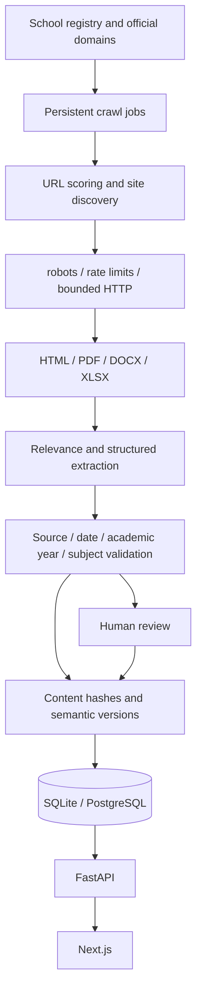

# Architecture

[繁體中文](ARCHITECTURE.md) | **English**

`frontend/` handles user interactions. `backend/` owns data contracts, persistence, and review. `crawler/` fetches and parses content, using the backend data layer to save results.

SQLite suits local development; PostgreSQL supports deployment across services. Redis and object storage can be introduced when queue or file capacity requires them; they are not included in the MVP.

The public API exposes only versions approved for publication. Admin APIs require a Bearer token. Production deployments should use TLS, a reverse proxy, and a private administration network, and move to individual accounts and permissions.

A school registry does not constitute verified exam data. Demo data is only for demonstrations and is excluded from official recall, accuracy, and coverage statistics. Production settings do not enable seed data by default.

Model extraction may consume only public content that has already been downloaded and parsed. Model providers should be integrated independently, with cost, schema, version, and confidence calibration. This version requires no API key and sends no documents to external models.
